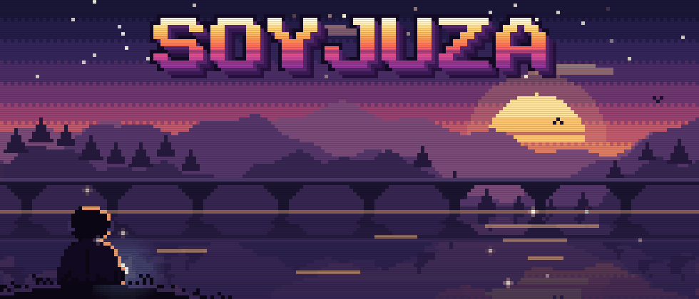

  

soy técnico en desarrollo de software y ahora estoy haciendo el tecnólogo en análisis y desarrollo de software en el SENA. programo desde el 2023, más que todo con typescript, node y react.

ahora estoy trabajando en un bot de whatsapp para tomar pedidos en restaurantes. lo hago con la librería [whatsapp-api-js](https://github.com/Secreto31126/whatsapp-api-js) y le faltaba la parte de administrar grupos, así que la hice yo: crear grupos, links de invitación, sacar participantes y manejar las solicitudes para unirse. fue mi primer aporte a un proyecto open source y ya quedó en la rama principal ([#546](https://github.com/Secreto31126/whatsapp-api-js/pull/546)).

otras cosas que he hecho:

- [aprende-autolayout](https://aprende-autolayout.vercel.app), una página para entender el auto layout de figma viendo al lado el flexbox que le corresponde
- [fispace studio](https://fispace-studio.vercel.app), la landing de un estudio, hecha para un cliente

 

  <picture>
    <source media="(prefers-color-scheme: dark)" srcset="https://skillicons.dev/icons?i=ts,nodejs,react,js,html,css,git,figma,linux,vercel&theme=dark">
    
  </picture>

 

<picture>
  <source media="(prefers-color-scheme: dark)" srcset="https://raw.githubusercontent.com/soyjuza/soyjuza/output/pacman-contribution-graph-dark.svg">
  <source media="(prefers-color-scheme: light)" srcset="https://raw.githubusercontent.com/soyjuza/soyjuza/output/pacman-contribution-graph.svg">
  
</picture>
